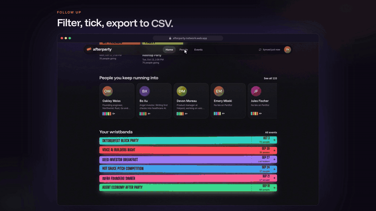
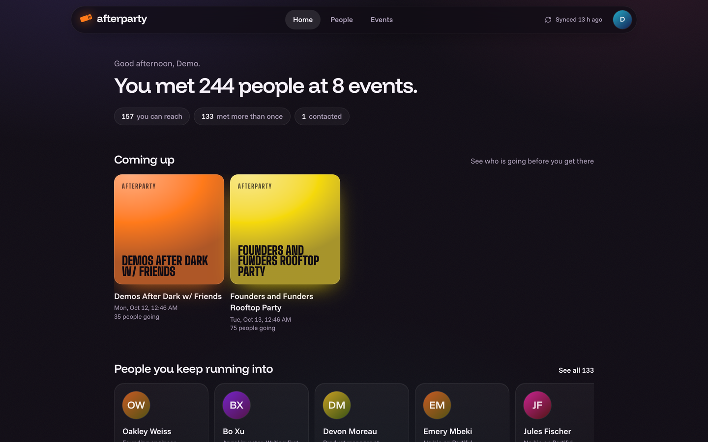
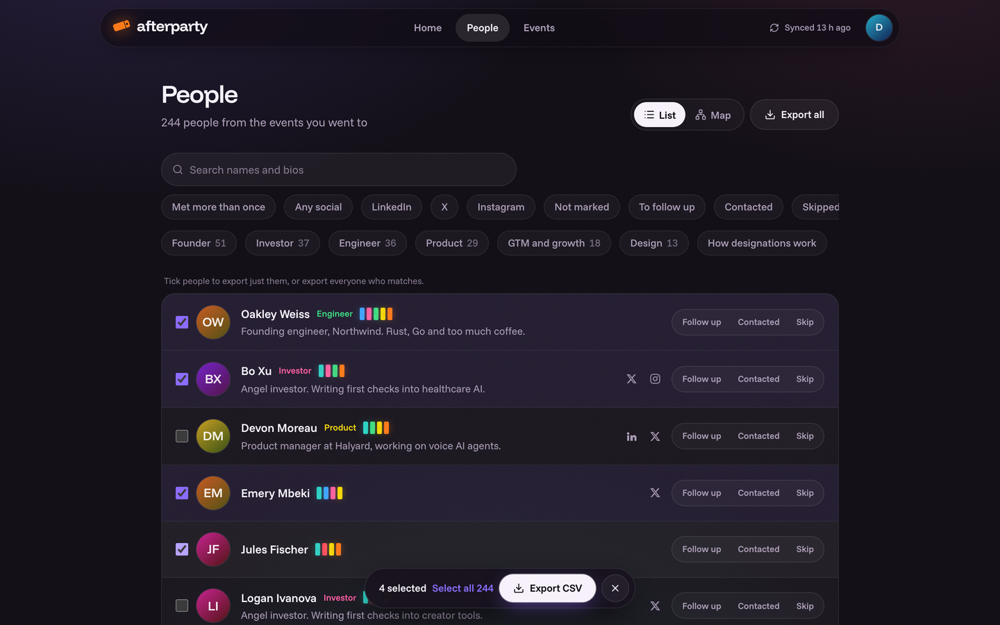
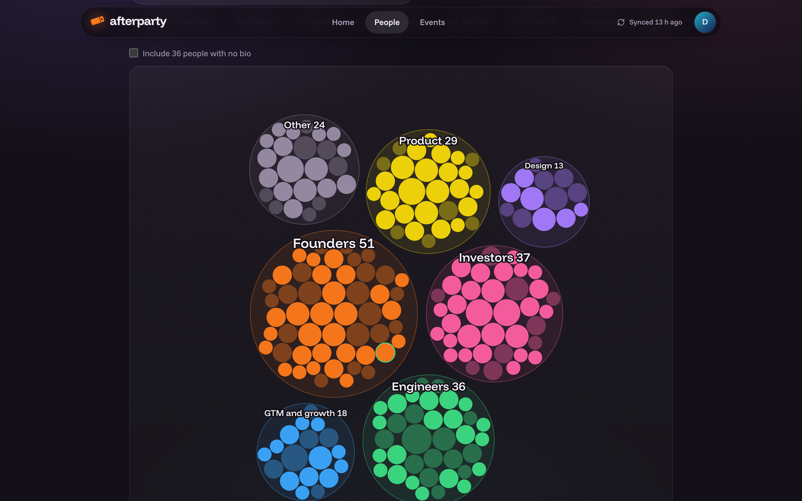
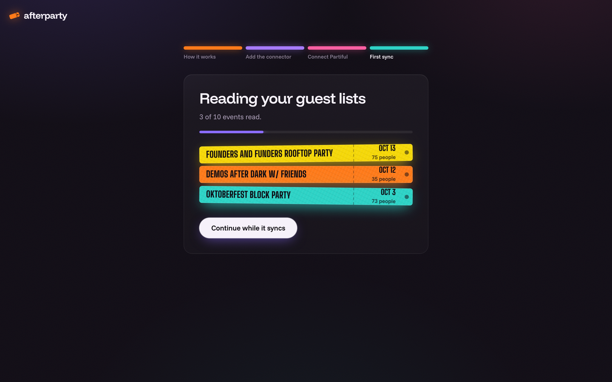
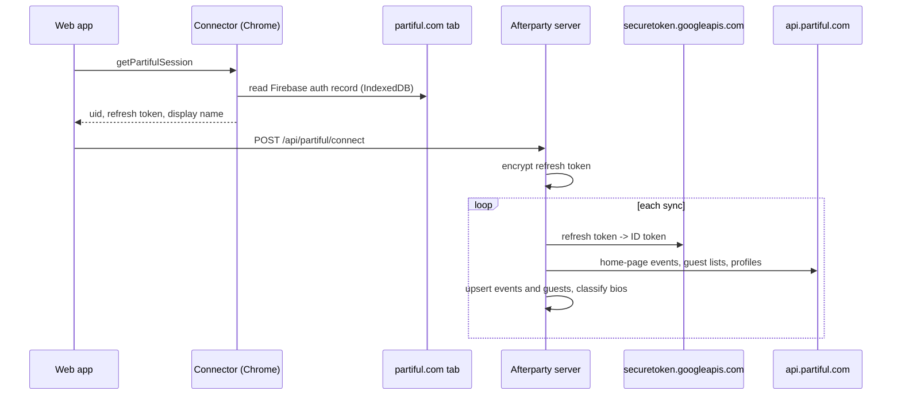

<p align="center">
  
</p>

<h1 align="center">Afterparty</h1>

<p align="center">
  <strong>Self-hosted Partiful scraper and guest list exporter.</strong><br>
  Sync the events and guest lists from your Partiful account into PostgreSQL. Search, filter, map and export the people to CSV.
</p>

<p align="center">
  <a href="https://github.com/doluz/afterparty/actions/workflows/ci.yml"></a>
  <a href="LICENSE"></a>
  
  
  
</p>

<p align="center">
  <a href="#quick-start">Quick start</a> ·
  <a href="docs/self-hosting.md">Self-hosting</a> ·
  <a href="docs/connector.md">Connector</a> ·
  <a href="docs/architecture.md">Architecture</a> ·
  <a href="https://afterparty-network.web.app">Hosted version</a> ·
  <a href="#use-with-ai-agents">AI agents</a> ·
  <a href="https://github.com/doluz/afterparty/releases/latest">Demo video</a> ·
  <a href="#author">Author</a>
</p>

<p align="center">
  
</p>

Afterparty reads your Partiful account through Partiful's web API: the events on your home page and the guest list of
each event you attended, hosted or will go to. It stores everything in PostgreSQL, deduplicates people across events,
classifies each person by the bio, and serves a web app to search, filter, map and export them. One Docker image,
no browser automation on the server.

**Hosted version:** do not want to run a server? Use [afterparty-network.web.app](https://afterparty-network.web.app).
It is invite-only: sign in with Google and request access. Same code, plus admin approval.

## Features

| Area | What you get |
|------|--------------|
| **Partiful sync** | Past and upcoming events from `getMyPastEventsForHomePage` and `getMyUpcomingEventsForHomePage`. Guest lists from `getGuests` with cursor pagination. Host guest lists from the event's Firestore `guests` collection plus `getUsers`. |
| **Daily resync** | Every connected account syncs again every 20 hours. A guest list is read again until 3 days after its event ends, then kept as is. One running sync per user, with a heartbeat. |
| **People** | One row per person across all events: name, photo, bio, LinkedIn, X, Instagram, TikTok, Facebook, times met, events shared, first and last met. |
| **Designations** | Keyword rules on the bio: Founder, Investor, Engineer, Product, Design, GTM and growth, Other, No bio. The rules are in [`core/roles.py`](src/afterparty/core/roles.py) and on the `/how-it-works` page. |
| **Filters** | Text search on name and bio, designation, has-social (any, LinkedIn, X, Instagram), met more than once, follow-up status, one event. |
| **People map** | Circle packing (d3-hierarchy) of everyone you met, grouped by designation. |
| **CSV export** | Any filter, a multi-select, or one event's guest list. Formula-injection guard on every cell. UTF-8 with BOM for Excel. |
| **Follow-up** | Per-person status (to follow up, contacted, skip) and a private note. |
| **Multi-user** | Every query is scoped by user ID. Local mode (email only) or Firebase Authentication (Google, email link). Optional `ALLOWED_EMAILS` allowlist. |
| **Security** | Partiful refresh tokens encrypted at rest with Fernet (`ENCRYPTION_KEY`) or Google Cloud KMS. CSP and security headers. The connector answers only the instance's own origin. |

### CSV columns

`name`, `first_name`, `last_name`, `designation`, `company_from_bio`, `bio`, `linkedin_url`, `x_url`, `instagram_url`,
`tiktok_url`, `facebook_url`, `partiful_url`, `times_met`, `events`, `first_met`, `last_met`, `follow_up`, `note`,
`partiful_user_id`

`first_name`, `last_name` and `company_from_bio` are there for enrichment tools such as Clay, Apollo or HubSpot.
`company_from_bio` is the text after "at" or "@" in the bio, for example "CEO at Lumen" gives "Lumen".

## Screenshots

<table>
  <tr>
    <td></td>
    <td></td>
  </tr>
  <tr>
    <td></td>
    <td></td>
  </tr>
</table>

All screenshots use made-up people.

## How it works



1. Partiful signs users in with Firebase Authentication and keeps the session in the browser.
2. The **Afterparty Connector** (Chrome, Manifest V3) reads that session from a partiful.com tab, one time, when you select **Connect Partiful**.
3. The server stores only the refresh token, encrypted. For each sync it gets a short-lived ID token and calls Partiful's API with read requests only.

Details: [docs/architecture.md](docs/architecture.md). Connector internals and permissions: [docs/connector.md](docs/connector.md).

## Quick start

You must have Docker with Docker Compose.

```bash
git clone https://github.com/doluz/afterparty.git
cd afterparty
cp .env.example .env
```

Make an encryption key and put it in `.env` as `ENCRYPTION_KEY`:

```bash
python3 -c "import base64,os; print(base64.urlsafe_b64encode(os.urandom(32)).decode())"
```

Start the server and PostgreSQL:

```bash
docker compose up -d --build
```

Open http://localhost:8080 and sign in with your email. This is **local mode** (`APP_ENV=dev`): no password, so the port is
published on 127.0.0.1 only. The setup pages then show how to load the connector and connect Partiful.

To run a shared instance, use Firebase sign-in: [docs/self-hosting.md](docs/self-hosting.md#set-up-firebase-sign-in).

## Run from source

You must have [uv](https://docs.astral.sh/uv/), Node.js 22 and Docker (for the local PostgreSQL).

```bash
make setup    # uv sync + npm ci
make dev      # PostgreSQL in Docker (port 54331), web build, server on http://localhost:8080
make seed     # optional: demo account with made-up people, sign in as demo@example.com
make test     # pytest against a real PostgreSQL, Partiful faked
make lint     # ruff + oxlint
make smoke    # headless Chromium on every page (needs `make dev` running)
```

In local mode the **Connect Partiful** step also shows **Use demo data**. It runs a first sync with made-up people, so you
can work on the app without a Partiful account.

## Use with AI agents

Afterparty works with any agent harness:

- **The [`afterparty` skill](skills/afterparty/SKILL.md)** (Agent Skills format: `SKILL.md` + `references/` + `scripts/`) teaches an agent to set up an instance, query and export your people, set follow-ups, sync, and change the code. It ships [`scripts/afterparty.py`](skills/afterparty/scripts/afterparty.py), an API client that needs only Python 3.9+.
- **[`AGENTS.md`](AGENTS.md)** gives coding agents the commands, the code map and the rules. Codex, Cursor, GitHub Copilot and most others read it directly; Claude Code reads it through [`CLAUDE.md`](CLAUDE.md).
- **[`llms.txt`](llms.txt)** indexes all docs for agents that fetch documentation.

### Install the skill

| Harness | How |
|---------|-----|
| Claude Code (all projects) | `git clone --depth 1 https://github.com/doluz/afterparty.git /tmp/afterparty && mkdir -p ~/.claude/skills && cp -r /tmp/afterparty/skills/afterparty ~/.claude/skills/` |
| Claude Code (one project) | Copy `skills/afterparty` into that project's `.claude/skills/` folder. |
| Any other harness with Agent Skills support | Copy `skills/afterparty` into that harness's skills folder. |
| Any agent, nothing installed | Start your prompt with: *"Read https://raw.githubusercontent.com/doluz/afterparty/main/skills/afterparty/SKILL.md and follow it."* |
| Working inside this repository | Nothing to install: the agent reads `AGENTS.md`, which points to the skill. |

### Give the agent access to your data

In Afterparty, open **Settings > API access for agents** and select **Copy API token**. Then give the agent:

```bash
export AFTERPARTY_URL=http://localhost:8080      # the address of your instance
export AFTERPARTY_AUTH="Bearer eyJ..."           # the token you copied (Firebase tokens expire after one hour)
# local mode only, in place of a token:
export AFTERPARTY_EMAIL=you@example.com
```

The client works without an agent too. The path is `skills/afterparty/scripts/afterparty.py` in the repository, or `~/.claude/skills/afterparty/scripts/afterparty.py` after you install the skill:

```bash
python3 skills/afterparty/scripts/afterparty.py stats
python3 skills/afterparty/scripts/afterparty.py people --cluster founder --repeat --all
python3 skills/afterparty/scripts/afterparty.py export investors.csv --cluster investor --social linkedin
python3 skills/afterparty/scripts/afterparty.py --help     # every command and filter
```

The full schema is at `/openapi.json` on every instance.

### Sample prompts

With the skill installed, ask in plain language. The agent picks the right command and asks you for anything it needs, such as the API token.

**Set up**

- "Set up Afterparty on my laptop with Docker, generate the encryption key, and tell me when it is ready for me to connect Partiful."
- "Run Afterparty from source with demo data so I can try it without a Partiful account."
- "Deploy Afterparty to Google Cloud Run with Cloud SQL and Cloud KMS. Ask me before you create anything that costs money."
- "Put my Afterparty behind Caddy on my VPS at afterparty.example.com with Firebase sign-in, and only allow @mycompany.com emails."

**Work with your data**

- "Who are the founders I met at more than one event? Show name, company and LinkedIn, most frequent first."
- "Export every investor I met with a LinkedIn link to investors.csv, ready to import into Clay."
- "Find everyone whose bio mentions voice AI and list the events where I met them."
- "Make a CSV of the Oktoberfest Block Party guest list, engineers only."
- "Sync Partiful again and tell me who is new since last week."
- "Mark Blake Quintero as contacted with the note 'coffee on Friday'."
- "Draft a short, personal follow-up message for the five founders I met most often. Do not send anything."
- "Which people have I marked to follow up but not contacted yet?"

**Change the code**

- "Add a Researcher designation for bios that mention 'research scientist' or 'PhD', and update the How it works page and the tests."
- "Add a github_url column to the CSV export, with a test."
- "Add custom tags on people: a migration, an API route, a filter, and tests."
- "Read the sync code and tell me how many requests a sync of 50 events makes to Partiful."

## Configuration

All settings are environment variables. [`.env.example`](.env.example) lists all of them.

| Variable | Default | Function |
|----------|---------|----------|
| `ENCRYPTION_KEY` | required | Fernet key for the Partiful refresh tokens. |
| `DATABASE_URL` | required | PostgreSQL connection string. Set by `docker-compose.yml`. |
| `APP_ENV` | `prod` | `dev` = local mode (no password). `prod` = Firebase sign-in. |
| `FIREBASE_PROJECT_ID`, `FIREBASE_WEB_CONFIG` | | Firebase project for sign-in in `prod`. |
| `ALLOWED_EMAILS` | empty | Who can sign in: addresses and `@domain` entries. Empty allows everyone. |
| `PUBLIC_URL` | `http://localhost:8080` | Address of the instance. The connector zip allows only this origin. |
| `BACKGROUND_SYNC` | `false` | Run the daily sync inside the server process. |
| `CRON_SECRET` | | Bearer token for `POST /internal/sync-all` from an external scheduler. |
| `EXTENSION_ID`, `CONNECTOR_STORE_URL` | | Your Chrome Web Store build of the connector, if you publish one. |
| `KMS_KEY` | | Google Cloud KMS key in place of `ENCRYPTION_KEY` (build with `EXTRAS=gcp`). |
| `PARTIFUL_DELAY` | `0.3` | Seconds between Partiful requests during a sync. |

## Deploy

The repository builds one image that serves the API and the web app. Run it with PostgreSQL 16 on any container host:
a VPS with Docker Compose behind Caddy or nginx, Fly.io, Render, Railway, or Google Cloud Run with Cloud SQL, Cloud KMS
and Cloud Scheduler. Steps, backups and upgrades: [docs/self-hosting.md](docs/self-hosting.md).

## API

The web app uses a small JSON API. All `/api/*` routes need a signed-in user, except `/api/health` and `/api/config`.
Scripts and agents send the token from **Settings > API access for agents**. The schema is at `/openapi.json`.

| Method and path | Function |
|-----------------|----------|
| `GET /api/me`, `DELETE /api/me` | Current user, connection and last sync. Delete removes the account and all its data. |
| `POST /api/partiful/connect`, `DELETE /api/partiful` | Store or remove the Partiful connection. Connect starts the first sync. |
| `POST /api/sync`, `GET /api/sync` | Start a sync, read its progress. |
| `GET /api/stats` | Counts for the home page. |
| `GET /api/events`, `GET /api/events/{id}` | Events, and one event with its guest list. |
| `GET /api/people`, `GET /api/people/{id}` | People with filters and paging, and one person with shared events. |
| `GET /api/people/map` | People grouped by designation for the map. |
| `POST /api/people/export` | CSV of a filter or a selection. |
| `PUT /api/people/{id}/follow-up` | Follow-up status and note. |
| `POST /internal/sync-all` | Daily sync of all users. `CRON_SECRET` or Cloud Scheduler OIDC. |
| `GET /afterparty-extension.zip` | The connector, built for `PUBLIC_URL`. |

## Project layout

```text
src/afterparty/             FastAPI server, sync, people queries, CSV export, migrations
src/afterparty/core/        Partiful data model, payload parser, designation rules
src/afterparty/connector.py Connector zip for the instance's origin
web/                        React 19, Vite 8, Tailwind CSS v4, TanStack Query (built into src/afterparty/static)
extension/                  Afterparty Connector, Chrome Manifest V3
scripts/                    Local PostgreSQL, demo data, connector packaging, UI smoke test
tests/                      pytest: API end to end on PostgreSQL with a fake Partiful, parser and rules
docs/                       Self-hosting, connector and architecture guides
skills/afterparty/          Agent Skill: SKILL.md, API reference, development guide, API client
AGENTS.md, llms.txt         Instructions and a docs index for AI agents
```

## Limits

- Partiful's web API is private and undocumented. A change on Partiful's side can break the sync until the parser is updated.
- Afterparty sees only what Partiful shows your account. Guest lists that a host hides stay hidden.
- Connecting needs a Chromium browser on a computer (Chrome, Arc, Brave, Edge). After that, the web app works on any device.
- Designations come from keyword rules on the bio, not from an LLM. People with no bio are "No bio".

## Data and privacy

Afterparty stores the guest lists that Partiful already shows you, and nothing that Partiful hides from you.
These people did not opt in to your marketing: contact them the way you would after you meet them at an event.
If you run an instance for other people, you are responsible for their data. Edit `web/src/pages/Privacy.tsx` to describe your instance.

## Contributing

Issues and pull requests are welcome. Read [CONTRIBUTING.md](CONTRIBUTING.md) first.
Report security problems in private: [SECURITY.md](SECURITY.md).

## Disclaimer

Afterparty is an independent project. It is not made by, endorsed by or affiliated with Partiful.
It uses Partiful's private web API with your own session. Read [Partiful's terms](https://partiful.com/terms) before you
use it with your account. You use it at your own risk.

## Author

Afterparty is built and maintained by **Sidhdharth (Sid) Sivasubramanian**, co-founder and CEO of
[MeetStream.ai](https://meetstream.ai).

[X @sidhdharth](https://x.com/sidhdharth) · [LinkedIn](https://www.linkedin.com/in/sidhdharthsivasubramanian) · [GitHub](https://github.com/doluz)

Afterparty started as a script to export Partiful guest lists after a week of San Francisco founder and AI events, and
grew into this app. It is a personal open-source project, not a MeetStream product.

### About MeetStream

[MeetStream](https://meetstream.ai) is meeting infrastructure for AI products. One API sends a bot into Zoom,
Google Meet and Microsoft Teams calls and gives you the meeting as data, in real time.

What developers build on it: AI note-takers, sales and interview copilots, meeting analytics, compliance recording,
and voice agents that join and speak in meetings.

- **Meeting bots** for Zoom, Google Meet and Microsoft Teams, with scheduling and calendar integration
- **Real-time media**: live audio streaming, and separate audio and video streams for each participant
- **Transcription**: real-time and post-call
- **In-meeting actions**: send chat messages and images into the call
- **Events and storage**: webhooks for bot status, participants and transcripts; recordings to your own S3 bucket
- **SDKs and tools**: [Python](https://github.com/meetstream-ai/meetstream-python), [Node.js](https://github.com/meetstream-ai/meetstream-node), [CLI](https://github.com/meetstream-ai/meetstream-cli) and an [MCP server](https://github.com/meetstream-ai/meetstream-mcp)

[Website](https://meetstream.ai) · [Docs](https://docs.meetstream.ai) · [Dashboard](https://app.meetstream.ai) · [X](https://x.com/meetstreamai) · [GitHub](https://github.com/meetstream-ai)

If you build something that needs to be in meetings, reach out to Sid on [X](https://x.com/sidhdharth) or [LinkedIn](https://www.linkedin.com/in/sidhdharthsivasubramanian).

## License

[MIT](LICENSE) © 2026 Sidhdharth Sivasubramanian
