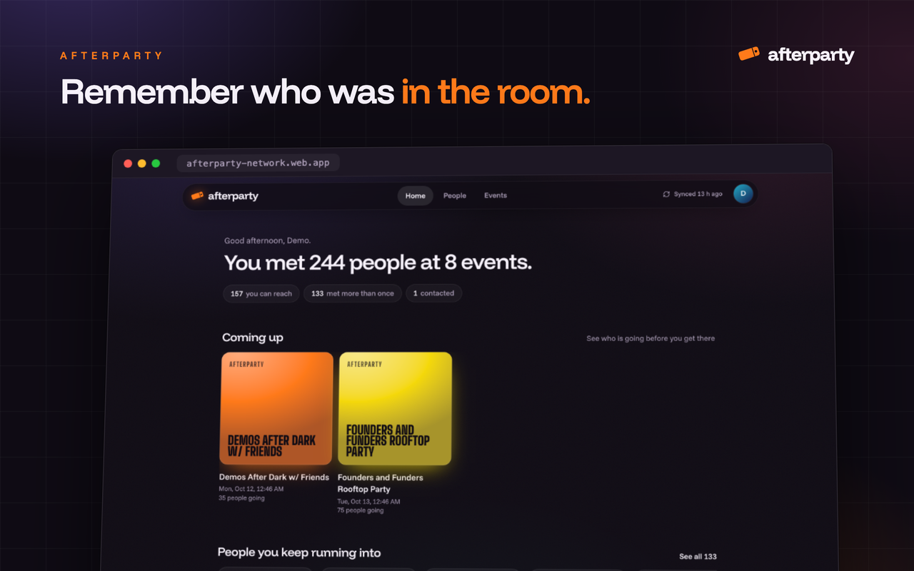
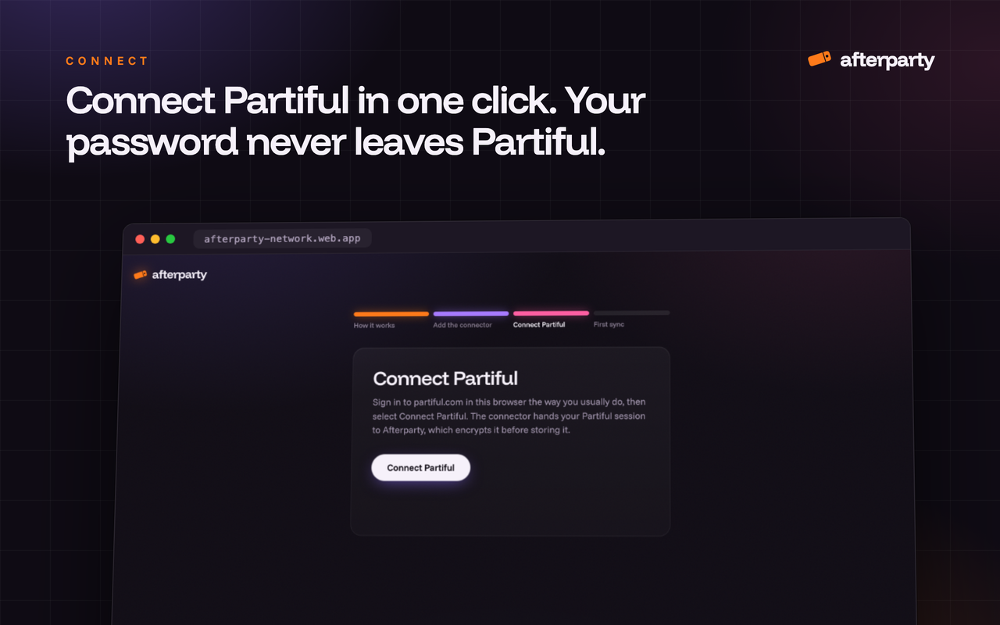
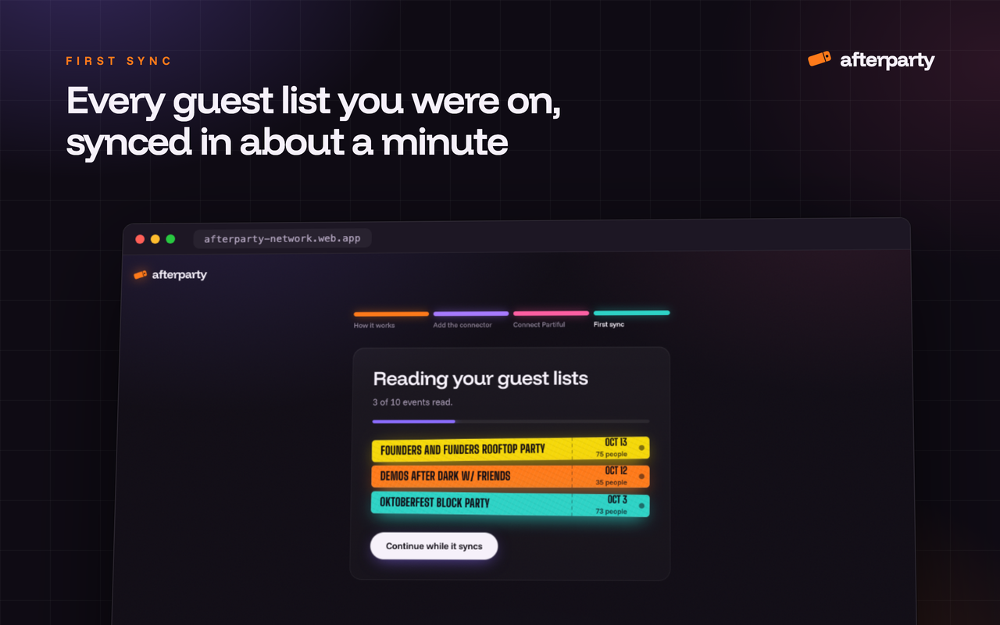
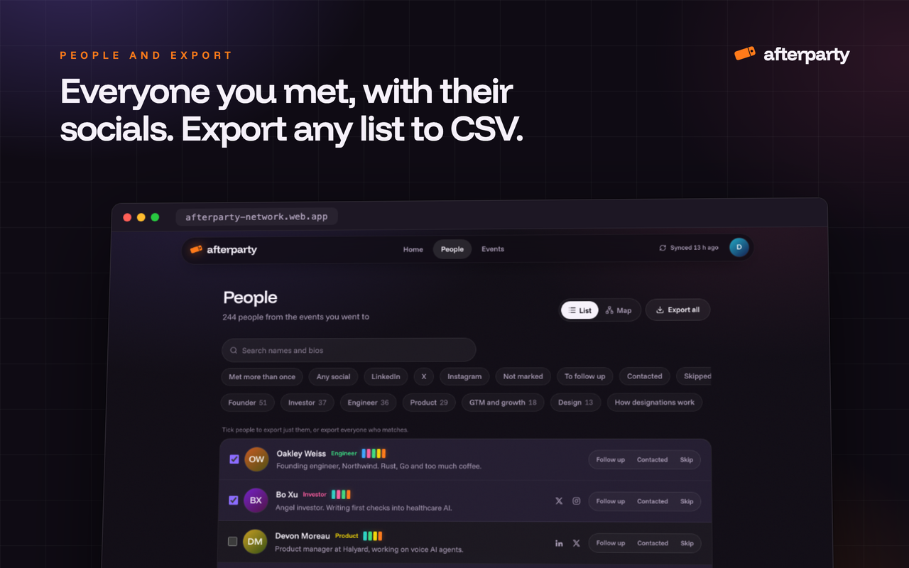
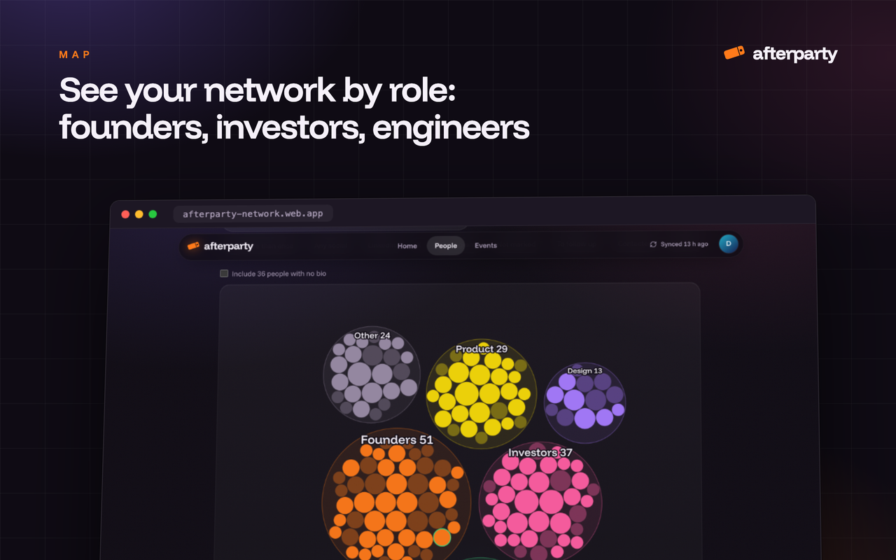

<p align="center">
  
</p>

<h1 align="center">Afterparty</h1>

<p align="center">
  <strong>Remember who was in the room.</strong><br>
  Turn the guest lists of the Partiful events you went to into one list of people to follow up with.
</p>

<p align="center">
  <a href="https://github.com/doluz/afterparty/actions/workflows/ci.yml"></a>
  <a href="LICENSE"></a>
  
  
</p>

<p align="center">
  <a href="#quick-start">Quick start</a> ·
  <a href="docs/self-hosting.md">Self-hosting</a> ·
  <a href="docs/connector.md">Connector</a> ·
  <a href="docs/architecture.md">Architecture</a> ·
  <a href="https://github.com/doluz/afterparty/releases/latest">Demo video</a> ·
  <a href="https://afterparty-network.web.app">Hosted version</a>
</p>

<p align="center">
  
</p>

You go to a lot of events. A week later, you remember a face and a company, but not the name.
Afterparty reads the guest lists that Partiful already shows you and gives you everyone you met in one place:
their bios, their LinkedIn, X and Instagram, the events you shared, and the people you keep running into.
Then you filter, tick and export to CSV for your CRM or enrichment tool.

## Features

- **Every guest list, one minute.** Connect Partiful one time. Afterparty reads every event you attended, hosted or are going to, then syncs again every day.
- **Everyone you met.** One list of people, with bios, socials, how many times you met, and your own follow-up status and notes.
- **Who you keep running into.** People you met at more than one event come first.
- **Designations from bios.** Founder, Investor, Engineer, Product, Design, GTM and growth, with [published rules](docs/architecture.md#designations) and no guessing.
- **People Map.** Your network grouped by role, at a glance.
- **Export anything to CSV.** Any filter, a hand-picked selection, or one event's guest list. Columns are ready for Clay, HubSpot, Attio or a spreadsheet.
- **Private by design.** Your Partiful sign-in is encrypted at rest. Each user sees only their own data. Afterparty never posts, RSVPs or messages anyone.
- **Yours to run.** One Docker image and Postgres. Personal mode with no sign-in setup, or Firebase sign-in for a shared, invite-only instance.

<p align="center">
  
</p>

<table>
  <tr>
    <td></td>
    <td></td>
  </tr>
  <tr>
    <td></td>
    <td></td>
  </tr>
</table>

## How it works

1. You sign in to Afterparty.
2. You add the **Afterparty Connector**, a small Chrome extension, and select **Connect Partiful**.
3. The connector reads your Partiful sign-in from partiful.com and gives it to Afterparty. The server encrypts it.
4. The server reads your events and their guest lists from Partiful's API, then one time each day after that.

The server never opens a browser and sends only read requests. Refer to [docs/architecture.md](docs/architecture.md) for the full design.

## Quick start

You must have Docker with Docker Compose.

```bash
git clone https://github.com/doluz/afterparty.git
cd afterparty
cp .env.example .env
```

Make an encryption key and put it in `.env` as `ENCRYPTION_KEY`:

```bash
python3 -c "import base64,os; print(base64.urlsafe_b64encode(os.urandom(32)).decode())"
```

Start Afterparty:

```bash
docker compose up -d --build
```

Open http://localhost:8080 and sign in with your email. This is **local mode**: it has no password, so it listens on your computer only.
The setup pages then tell you how to add the connector and connect Partiful.

To share an instance with other people, set up Firebase sign-in first. Refer to [docs/self-hosting.md](docs/self-hosting.md).

## Run from source

You must have [uv](https://docs.astral.sh/uv/), Node.js 22 and Docker (for the local Postgres).

```bash
make setup    # Python and web dependencies
make dev      # Postgres in Docker, web build, server on http://localhost:8080
make seed     # optional: a demo account with made-up people (sign in as demo@example.com)
make test     # API and parser tests
```

On the **Connect Partiful** step, local mode also shows **Use demo data**. It plays a first sync with made-up people, so you can see the full flow without a Partiful account.

## Configuration

All settings come from environment variables. The most important:

| Variable | Function |
|----------|----------|
| `ENCRYPTION_KEY` | Required. Encrypts the Partiful sign-ins at rest. |
| `APP_ENV` | `dev` is local mode (no password). `prod` uses Firebase sign-in. |
| `PUBLIC_URL` | The address of your instance. The connector answers only this address. |
| `AUTO_APPROVE` | `true` lets every new sign-in in. `false` makes an admin approve each user. |
| `ADMIN_EMAILS` | Accounts that see the Access page. |
| `BACKGROUND_SYNC` / `CRON_SECRET` | How the daily sync runs. |

[`.env.example`](.env.example) lists every setting, and [docs/self-hosting.md](docs/self-hosting.md#settings) explains each one.

## Deploy

The repository builds one container image that serves the API and the web app. Run it anywhere that runs containers, with PostgreSQL 16 next to it:
a VPS with Docker Compose and a reverse proxy, Fly.io, Render, Railway, or Google Cloud Run with Cloud SQL and Cloud KMS.
[docs/self-hosting.md](docs/self-hosting.md) has the steps.

## Project layout

```text
src/afterparty/       FastAPI server, sync, CSV export, migrations
src/afterparty/core/  Partiful data model, payload parser, designation rules
web/                  React + Vite + Tailwind web app (built into src/afterparty/static)
extension/            The Afterparty Connector (Chrome, Manifest V3)
scripts/              Local Postgres, demo data, connector packaging, UI smoke test
tests/                API and parser tests (pytest, real Postgres, Partiful faked)
docs/                 Self-hosting, connector and architecture guides
```

## Privacy

Afterparty stores the guest lists that Partiful already shows you, and nothing that Partiful hides from you.
These are people who were at an event with you, not people who opted in to your marketing. Reach out the way you would after meeting them in person.
If you run an instance for other people, you are responsible for their data. Edit the privacy page in `web/src/pages/Privacy.tsx` to describe your instance.

## Contributing

Issues and pull requests are welcome. Read [CONTRIBUTING.md](CONTRIBUTING.md) first.
To report a security problem, follow [SECURITY.md](SECURITY.md). Do not open a public issue for it.

## Disclaimer

Afterparty is an independent project. It is not made by, endorsed by or affiliated with Partiful.
It uses Partiful's private web API with your own sign-in. That API can change at any time and break Afterparty.
Read [Partiful's terms](https://partiful.com/terms) and decide for yourself before you use Afterparty with your account. You use it at your own risk.

## License

[MIT](LICENSE) © 2026 Sidhdharth Sivasubramanian
