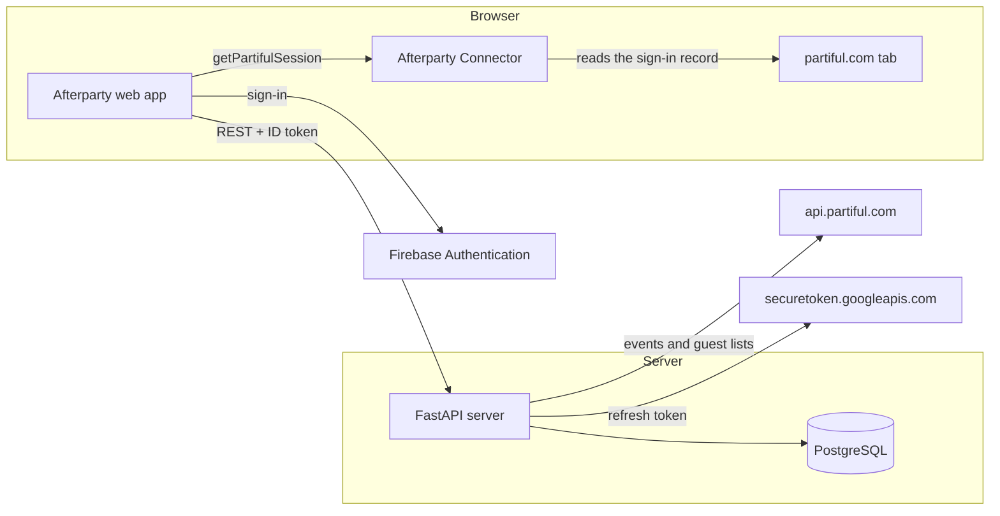

# Architecture

Afterparty is one Python server, one PostgreSQL database, one web app and one Chrome extension.

## Components

| Component | Location | Function |
|-----------|----------|----------|
| Server | `src/afterparty/` | FastAPI. Serves the REST API under `/api/` and the built web app. Applies the database migrations at start. |
| Partiful data | `src/afterparty/core/` | Data model, parser for the Partiful payloads, and the designation rules. |
| Partiful client | `src/afterparty/partiful_api.py` | Gets a Partiful ID token from the refresh token. Sends the API calls with retries. |
| Sync | `src/afterparty/sync.py` | Reads the events and the guest lists of one user into the database. |
| People | `src/afterparty/people.py` | Filters for the people list, and the CSV export. |
| Connector zip | `src/afterparty/connector.py` | Makes the connector zip file for the address of the instance. |
| Web app | `web/` | React, Vite and Tailwind CSS. The build goes into `src/afterparty/static/`. |
| Connector | `extension/` | Chrome extension, Manifest V3. |

## How Afterparty reads Partiful

Partiful uses Firebase Authentication. The Partiful web app keeps the sign-in of the user in the browser.

1. The connector reads the refresh token from that record and gives it to the web app.
2. The server encrypts the refresh token and keeps it in `partiful_accounts`.
3. For each sync, the server sends the refresh token to `securetoken.googleapis.com` and gets a short-lived ID token.
4. The server calls `api.partiful.com` with the ID token. It reads the events on the Partiful home page.
5. For each event that the user attended, hosted or will go to, the server reads the guest list.
6. For an event that the user hosts, Partiful refuses `getGuests`. The server then reads the guest list from the Firestore collection of the event.

The server does not open a browser. It sends only read requests to Partiful.

## When a person counts as met

A person counts as "met" if the person was on the guest list of an event that the user attended.
An event that the user hosts counts only after it starts. The RSVPs for a future party are not people that the user met.

## Designations

Partiful has no job title field. Afterparty reads the bio of each person.
The rules in `src/afterparty/core/roles.py` check the bio in a fixed order. The first group that has a word in the bio wins.
The groups are Founder, Investor, Engineer, Product, Design, GTM and growth, Other, and No bio.
The page `/how-it-works` in the web app shows the same rules.

## Database

| Table | Contents |
|-------|----------|
| `users` | Afterparty accounts: the email, the name and the setup state. |
| `partiful_accounts` | One Partiful connection for each user, with the encrypted refresh token. |
| `events` | The Partiful events of each user. |
| `guests` | The guest list of each event, for each user. |
| `follow_ups` | The follow-up status and the note of a user for a person. |
| `sync_runs` | The progress and the result of each sync. |

Each query has the ID of the user in its filter. A user cannot see the data of a different user.
The migrations are in `src/afterparty/migrations/`. The server applies new files in name order when it starts.

## Security

- The server encrypts each Partiful refresh token with `ENCRYPTION_KEY` (Fernet) or with a Google Cloud KMS key. The token never goes back to the browser.
- In Firebase mode, the server accepts only Firebase ID tokens with a verified email.
- Local mode works only when `APP_ENV=dev`. It does not work on Cloud Run, because Cloud Run sets `K_SERVICE`.
- The connector answers only the addresses in its manifest.
- The CSV export puts an apostrophe before a cell that starts with `=`, `+`, `-`, `@` or a tab. This prevents formula injection in spreadsheets.
- The server sends security headers, which include a Content Security Policy.
